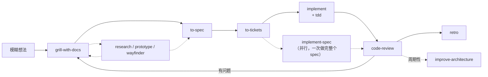

# 给真实工程师的 Agent Skills

这是一套基于 Matt Pocock `skills` 思想整理的 Agent Skills，当前同步到上游 `v1.3.2`。它服务的是把软件工程基本功变成可重复的协作习惯：持续对齐、快速反馈、垂直切片、测试驱动和保持代码设计。

这份 README 是我对这套 skills 的使用与理解，不是 Matt Pocock 的官方中文版，也不替代各 skill 自己的说明。后续会根据实际使用中的反馈、面试交流和工程实践持续修正与演进。

我对这套方法的理解是：它不是一条瀑布式流程，也不是文档驱动开发。它更像一组可以组合的反馈循环。文档、工单和术语都只是持久化共识的载体，真正的目标是让人和 Agent 对问题、边界和验收方式达成一致，并用足够快、足够干净的反馈把实现逐步收敛。

## 更新说明

上游从 `v1.2.3` 到 `v1.3.2` 的变动，用中文重新组织了一份：[CHANGELOG.zh-CN.md](./CHANGELOG.zh-CN.md)。想知道「跟我以前用的版本比多了什么、我要不要动手改」，读这份；想查证某个改动的英文原文，读上游的 [`CHANGELOG.md`](./CHANGELOG.md)。

## 它解决什么问题

AI coding 最常见的失败，是上下文和反馈出了问题。

| 常见失真 | 对应的处理方式 |
| --- | --- |
| 需求只有一句话，Agent 只能猜 | 用 `grill-me` 或 `grill-with-docs` 逐个追问，暴露取舍和边界 |
| 重要决策只存在于一次对话里 | 用 `to-spec` 把共识写成可交接的目的地文档 |
| 一个大任务无法验收，也无法并行 | 用 `to-tickets` 拆成可独立验证的 tracer-bullet 工单，并标出 blocking 关系 |
| 设计在文字里想不清楚 | 用 `prototype` 提高保真度，用可丢弃代码回答问题 |
| Agent 写完一大坨代码才发现方向错了 | 用 `tdd` 建立 red-green-refactor 反馈环，一次推进一个垂直切片 |
| 评审被长对话里的错误假设污染 | 在 fresh context 中用 `code-review`，分别检查规范和需求 |
| 代码越改越难改 | 定期用 `improve-codebase-architecture` 寻找 deepening 机会 |
| 同一类机械错误反复出现 | 用 `retro` 把它变成 lint 规则、CI job 或 `CODING_STANDARDS.md` |

核心原则可以压缩成一句话：**先把问题问清楚，再用最短反馈环验证它；不要把“写了很多文档”误认为“已经完成设计”。**

## 30 秒看懂主流程



这张图不是必须照做的阶段顺序。小改动可以直接 `implement`，复杂问题可以在 `wayfinder` 中建立决策地图。每一步存在的理由，是缩短反馈距离，减少 Agent 猜测，而不是增加流程仪式感。

## 三分钟开始

### 1. 安装

先选一条路线，两条都装会让每个技能出现两次，行为很难解释。能自动更新的插件是只读订阅，skills.sh 写的是你自己的可编辑文件，两者互斥。

**路线 A：上游官方，装完能自己更新**

| Agent | 安装来源 | 会自动更新吗 |
| --- | --- | --- |
| Claude Code | `claude-plugins-official` | 默认自动 |
| Codex | `mattpocock` marketplace | 启动时自动 |
| GitHub Copilot（CLI 与 VS Code） | `mattpocock` marketplace | 一次 `autoUpdate` 之后自动 |
| Gemini CLI | `gemini skills install`（复制文件） | 不会，重跑命令 |
| 其他 agent，或想要可编辑文件 | skills.sh | 不会，`npx skills@latest update` 并重跑 `add` |

<details>
<summary><strong>Claude Code</strong></summary>

```bash
claude plugin install mattpocock-skills@claude-plugins-official
```

默认自动更新。

</details>

<details>
<summary><strong>Codex</strong></summary>

```bash
codex plugin marketplace add mattpocock/skills
codex plugin add mattpocock-skills@mattpocock
```

启动时自动更新。

</details>

<details>
<summary><strong>GitHub Copilot</strong>（CLI 与 VS Code）</summary>

```bash
copilot plugin marketplace add mattpocock/skills
copilot plugin install mattpocock-skills@mattpocock
```

然后一次性在 `~/.copilot/settings.json` 里加上：

```json
{
  "extraKnownMarketplaces": {
    "mattpocock": { "source": { "source": "github", "repo": "mattpocock/skills" }, "autoUpdate": true }
  }
}
```

VS Code 里运行 **Chat: Install Plugin From Source**，输入 `https://github.com/mattpocock/skills`，每天自动更新。

</details>

<details>
<summary><strong>Gemini CLI</strong>（手动更新）</summary>

```bash
gemini skills install https://github.com/mattpocock/skills.git --path skills/engineering
gemini skills install https://github.com/mattpocock/skills.git --path skills/productivity
```

两条命令都重跑一次就是更新。

</details>

<details>
<summary><strong>其他 agent，或想要可编辑文件</strong>（手动更新）</summary>

```bash
npx skills@latest add mattpocock/skills -a <agent>  # cursor, opencode, devin, windsurf, amp, pi; 省略 -a 则让你选
```

安装器问要装哪些技能时，请确保勾上 `setup-matt-pocock-skills`。更新用 `npx skills@latest update`，再重跑 `add` 才能拿到新技能。

</details>

**路线 B：本仓库（fork）**

本仓库跟随上游主线，额外维护了中文文档和 in-progress 里的 beta 技能，所以走 skills.sh：

```bash
npx skills@latest add yuezi2048/skills
```

更新时运行 `npx skills@latest update`，再重跑一次 `add` 拿新技能。这样拿到的是一份可编辑的副本，不会自动跟着上游变。

### 2. 初始化项目

在每个项目中运行一次：

```text
/setup-matt-pocock-skills
```

它会问你三件事：用哪个 issue tracker（GitHub、GitLab、本地文件，或你描述的任意方式）、triage 时给 ticket 打什么标签、文档写到哪。之后 `to-spec`、`to-tickets`、`triage` 等工程技能才能把产物放到团队真正使用的地方。

### 3. 最短链路

```text
/grill-me
/to-spec
/to-tickets
/implement
/code-review
/retro
```

如果需求还没有形成共识，先不要让 Agent 实现。若问题大到一次会话无法容纳，先用 `/wayfinder` 把未知决策拆开。

## 我理解的关键思想

### 1. 从流程转向反馈循环

传统流程容易被理解成“先写完整 spec，再一次性生成代码”。这套 skills 的重点不同：共识在 grilling 中形成，研究和原型用来消除未知，实现阶段依靠测试和 QA 持续修正。

因此，`spec` 不是详细设计的替代品，也不是写完就不能改变的合同。它记录问题、目标、用户故事、重要决策、测试决策和明确不做什么，让下一个会话能重建上下文。真正的设计仍然要在代码和反馈中接受检验。

### 2. 统一语言让 Agent 更少猜

`grill-with-docs` 和 `domain-modeling` 会维护领域术语、`GLOSSARY.md` 与 ADR。人和 Agent 使用同一套词，模块、函数和测试的命名就有了共同依据。

例如，先约定 `ghost`、`real`、`materialize`、`materialization cascade` 的含义，再讨论课程功能。这样比每次重新解释“数据库里有但磁盘里没有的课程”更精确，也更省上下文。

### 3. Prototype 是高保真度的提问

有些问题不是继续讨论就能解决的，例如“这个 UI 用起来顺不顺”“状态机的转移是否自然”。生产代码便宜之后，先写一个 throwaway prototype 往往比继续扩写 spec 更快得到答案。

原型可以是 UI 变体，也可以是后端状态模型或命令行逻辑。它的价值不在于直接合并，而在于把“我想看看它运行起来是什么样”变成可观察的反馈。

### 4. TDD 是防止 AI 作弊的边界

`to-tickets` 产生的是能验收的垂直切片，`tdd` 则为每个切片建立 red-green-refactor 回路：先写失败测试，再实现最小行为，最后整理设计。测试是 Agent 无法靠口头解释绕过的反馈源，也是让重构不会破坏既有行为的耐久接口。

### 5. Fresh context 让评审保持诚实

长对话会积累错误假设，也会让评审者下意识替实现找理由。`code-review` 从固定点读取 diff，在 Standards 和 Spec 两条轴上独立检查。它的目的不是增加一个审批环节，而是让反馈更快、更干净，更难被错误上下文掩盖。

同一个道理现在也写进了所有派发子 Agent 的技能：**子 Agent 要用一个全新的上下文窗口启动，而不是 fork 当前对话**。有些 harness（Codex 就是）默认 fork 父对话，而 fork 会把父对话的上下文一起继承下来，那正是子 Agent 本来要逃离的东西。`implement-spec` 因此给每个 ticket 一个全新的实现者。

### 6. 会话结束后改环境，不改代码

`retro` 回到一次会话本身，只提对 Agent 工作环境的建议：导航指针、自动化检查、编码规范、steering 文件、工具选择。它的分类动作很明确，机械性的违规就应该变成确定性检查（lint 规则、pre-commit 钩子或 CI job），只有真正需要判断力的才留在 `CODING_STANDARDS.md` 里。

## 如何选择入口

| 你现在的情况 | 从这里开始 |
| --- | --- |
| 不知道该用哪个 skill | [`ask-matt`](./skills/engineering/ask-matt/SKILL.md) |
| 有想法但需求模糊 | [`grill-me`](./skills/productivity/grill-me/SKILL.md) |
| 想在追问中同步沉淀术语和决策 | [`grill-with-docs`](./skills/engineering/grill-with-docs/SKILL.md) |
| 工作量超过一次会话，未知决策很多 | [`wayfinder`](./skills/engineering/wayfinder/SKILL.md) |
| 需要验证 UI 或逻辑形态 | [`prototype`](./skills/engineering/prototype/SKILL.md) |
| 已有共识，需要形成目的地文档 | [`to-spec`](./skills/engineering/to-spec/SKILL.md) |
| 已有 spec，需要可执行切片 | [`to-tickets`](./skills/engineering/to-tickets/SKILL.md) |
| 想测试驱动实现 | [`tdd`](./skills/engineering/tdd/SKILL.md) |
| 已完成一段实现，需要独立评审 | [`code-review`](./skills/engineering/code-review/SKILL.md) |
| 正在定位复杂 bug 或性能回归 | [`diagnosing-bugs`](./skills/engineering/diagnosing-bugs/SKILL.md) |
| 不确定术语或需要更新领域模型 | [`domain-modeling`](./skills/engineering/domain-modeling/SKILL.md) |
| 会话结束了，想改好下次的环境 | [`retro`](./skills/engineering/retro/SKILL.md) |
| 需要把当前会话交给另一个 Agent | [`handoff`](./skills/productivity/handoff/SKILL.md) |

## 技能地图

技能按两个维度组织：按工程领域分 bucket，按谁可以触发分 invocation。**User-invoked** 只能由人主动输入，负责编排和关键入口；**Model-invoked** 可以由 Agent 根据任务自动调用，负责可复用的工程纪律。user-invoked 技能可以调用 model-invoked 技能，但不会调用另一个 user-invoked 技能。

### Engineering

**User-invoked**

- [`ask-matt`](./skills/engineering/ask-matt/SKILL.md)：根据当前情况选择入口。在说出某个技能做什么、或建议跳过某一步之前，它必须先读那个技能的 `SKILL.md`，不靠自己的摘要。
- [`grill-with-docs`](./skills/engineering/grill-with-docs/SKILL.md)：追问需求，同时更新术语、`GLOSSARY.md` 和 ADR。
- [`triage`](./skills/engineering/triage/SKILL.md)：用状态机把 issue 推进到各个 triage 角色。
- [`improve-codebase-architecture`](./skills/engineering/improve-codebase-architecture/SKILL.md)：扫描架构深化机会，先给出可视化 HTML 报告，再针对你选中的那个展开追问。它是勘察而不是抢救，老仓库上能找到真实候选，但不会替你把泥潭解开。
- [`setup-matt-pocock-skills`](./skills/engineering/setup-matt-pocock-skills/SKILL.md)：每个仓库首次使用前完成配置（issue tracker、triage 标签、领域文档布局）。
- [`to-spec`](./skills/engineering/to-spec/SKILL.md)：把当前对话整理成 spec 并发布到 issue tracker，不再访谈，只综合你已经讨论过的内容。
- [`to-tickets`](./skills/engineering/to-tickets/SKILL.md)：把任何计划、spec 或对话拆成 tracer-bullet ticket，每个声明自己的 blocking 边，可写成本地文本文件，也可以写成真实 tracker 上的原生 blocking 链接。
- [`implement`](./skills/engineering/implement/SKILL.md)：按 spec 或 tickets 实现，在预先约定的 seam 上驱动 `/tdd`，提交前用 `/code-review` 收尾。
- [`implement-spec`](./skills/engineering/implement-spec/SKILL.md)：在一条集成分支上实现整个 spec，把 tickets 当任务图，在就绪的 frontier 上并行跑实现子 Agent，收尾接评审。
- [`wayfinder`](./skills/engineering/wayfinder/SKILL.md)：把超出单会话容量的大块工作，做成 issue tracker 上共享的决策 ticket 地图，逐个解除，直到通往目的地的路清晰为止。它产出决策，不产出交付物。
- [`retro`](./skills/engineering/retro/SKILL.md)：会话结束后，按严重程度提出对 Agent 环境的改进建议。

**Model-invoked**

- [`prototype`](./skills/engineering/prototype/SKILL.md)：用可丢弃原型回答设计问题，状态或逻辑问题产出一个可分享的 HTML 文件，UI 问题产出几个差异极大、可在同一路由切换的变体。
- [`diagnosing-bugs`](./skills/engineering/diagnosing-bugs/SKILL.md)：按“复现、缩小、假设、观测、修复、回归测试”诊断复杂故障，先建立一条会对这个 bug 变红的紧反馈环，再开始推理。
- [`research`](./skills/engineering/research/SKILL.md)：以后台 agent 的形式，基于高可信一手来源完成技术调研，把结论写成仓库里带引用的 Markdown 文件。
- [`tdd`](./skills/engineering/tdd/SKILL.md)：执行 red-green-refactor，一次推进一个垂直切片。
- [`domain-modeling`](./skills/engineering/domain-modeling/SKILL.md)：持续打磨领域模型，拿术语表挑战用词，用边界场景压测，就地更新 `GLOSSARY.md` 和 ADR。
- [`codebase-design`](./skills/engineering/codebase-design/SKILL.md)：设计 deep module 和可测试的 seam，提供 module、interface、depth、seam、adapter 这套共同词汇。
- [`code-review`](./skills/engineering/code-review/SKILL.md)：从固定点读取 diff，在 Standards、Spec 两条轴上独立评审，两个子 Agent 并行，互不污染。
- [`pr`](./skills/engineering/pr/SKILL.md)：规定 PR 正文的形状，用最小可视化说明改动、附前后对照证据，并给出合并风险判断（单向门还是双向门，影响半径多大）。
- [`wizard`](./skills/engineering/wizard/SKILL.md)：生成只需要人操作的交互式 bash 向导，例如开通基础设施、配置凭据或 CI secret、走一遍陌生的第三方面板、跑一次性的迁移或切换。

### Productivity

**User-invoked**

- [`grill-me`](./skills/productivity/grill-me/SKILL.md)：对计划或设计进行持续追问，直到设计树的每个分支都有结论。
- [`handoff`](./skills/productivity/handoff/SKILL.md)：把当前会话压缩成交接文档，让另一个 Agent 能继续这项工作。
- [`teach`](./skills/productivity/teach/SKILL.md)：在多个会话中进行有状态教学，用当前目录作为教学工作区。
- [`to-questionnaire`](./skills/productivity/to-questionnaire/SKILL.md)：把无法独自回答的决策整理成 Markdown 问卷，交给唯一能回答的人异步填写或开会一起填。它追问的是发送方式，不是问卷主题。
- [`wait-what`](./skills/productivity/wait-what/SKILL.md)：当信息没有被理解时，要求 Agent 用你缺的上下文、按 `GLOSSARY.md` 的词汇换一种方式重讲。

**Model-invoked**

- [`grilling`](./skills/productivity/grilling/SKILL.md)：所有追问型技能共用的底层访谈能力，被 `grill-me`、`grill-with-docs`、`triage`、`wayfinder`、`improve-codebase-architecture` 共同使用。
- [`writing-for-agents`](./skills/productivity/writing-for-agents/SKILL.md)：编写给 Agent 消费的 skills、AGENTS.md、CLAUDE.md，以及任何通过指针被 Agent 读到的文档。

### In progress

beta 技能放在 `skills/in-progress/`：公开征求意见，不进 plugin，不进这份 README，也不给 docs 页，可能随时改动或消失。清单见 [`skills/in-progress/README.md`](./skills/in-progress/README.md)。

## 设计边界

- 小而明确的改动不必强行走完整链路，反馈环应当比流程更重要。
- `to-spec` 记录决策和验收边界，不记录容易过时的代码路径和大段实现代码。
- `to-tickets` 默认按垂直切片拆分，一个 ticket 应能独立验证；互不阻塞的 frontier 才适合并行。
- `prototype` 默认是用完即弃的探索物，不应未经判断直接当作生产代码。
- `code-review` 的独立上下文只隔离对话，不隔离文件系统；并行实现仍需要分支、worktree 和文件所有权约束。
- 子 Agent 用全新的上下文窗口启动，不要 fork 当前对话，否则它会继承本该逃离的上下文。
- skill 不会替用户授权 push、merge、部署或关闭 issue。
- 验证强度跟随风险，低风险改动不机械要求全量测试，高风险逻辑必须覆盖对应验证面。

## 来源与定位

本仓库遵循 [Matt Pocock 的 skills](https://github.com/mattpocock/skills) 的核心思想，并结合中文笔记中的学习和实践理解进行说明。除上游技能外，本仓库在 `skills/in-progress/` 下还维护了自己的 beta 技能（清单见该目录的 README）；其余目录中的实现仍以各自的 [`SKILL.md`](./skills/engineering/README.md) 为准，本 README 的职责是帮助读者快速理解整套方法如何工作。

这套方法最适合这样描述：**人负责把“要解决什么问题、为什么这样解决、做到什么算完成”说清楚，Agent 负责在快速反馈中实现、验证和修正。**

## 许可

本项目沿用上游 MIT License，详见 [`LICENSE`](./LICENSE)。
