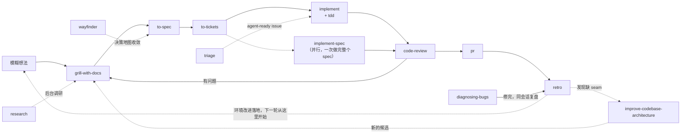

# 给真实工程师的 Agent Skills

这是一套基于 Matt Pocock `skills` 思想整理的 Agent Skills，当前同步到上游 `v1.3.2`。它服务的是把软件工程基本功变成可重复的协作习惯：持续对齐、快速反馈、垂直切片、测试驱动和保持代码设计。

这份 README 是我对这套 skills 的使用与理解，不是 Matt Pocock 的官方中文版，也不替代各 skill 自己的说明。后续会根据实际使用中的反馈、面试交流和工程实践持续修正与演进。

我对这套方法的理解是：它不是一条瀑布式流程，也不是文档驱动开发。它更像一组首尾相接的反馈循环。文档、工单和术语都只是持久化共识的载体，真正的目标是让人和 Agent 对问题、边界和验收方式达成一致，并用足够快、足够干净的反馈把实现逐步收敛。**一轮结束之后的复盘，是下一轮变快的唯一途径。**

## 更新说明

上游从 `v1.2.3` 到 `v1.3.2` 的变动，用中文重新组织了一份：[CHANGELOG.zh-CN.md](./CHANGELOG.zh-CN.md)。想知道「跟我以前用的版本比多了什么、我要不要动手改」，读这份；想查证某个改动的英文原文，读上游的 [`CHANGELOG.md`](./CHANGELOG.md)。

这一版最值得记住的三件事：

1. **主流程收口在 `retro`**。它不提代码意见，只提 Agent 工作环境的改进，所以它是唯一能让「下一轮更好」的步骤。
2. **安装方式改成插件优先**，能自动更新的路线排在前面，skills.sh 退到「手动更新」。
3. **子 Agent 一律用全新上下文启动**，不再 fork 当前对话。

### 从旧版本过来要动什么

- 老仓库的 `CONTEXT.md` / `CONTEXT-MAP.md` 改名成 `GLOSSARY.md` / `GLOSSARY-MAP.md`，内容不用动。
- 重跑一次 `/setup-matt-pocock-skills`，刷新 `docs/agents/` 下的 tracker、标签和领域文档配置。
- 不再调用 `/resolving-merge-conflicts`，它已经删除，冲突交给 Agent 常规处理。
- 团队约定里如果有「派子 Agent 时 fork 当前对话」，改成全新上下文窗口。

完整清单见 [CHANGELOG.zh-CN.md](./CHANGELOG.zh-CN.md) 的升级检查清单。

## 它解决什么问题

AI coding 最常见的失败，是上下文和反馈出了问题。

| 常见失真 | 对应的处理方式 |
| --- | --- |
| 需求只有一句话，Agent 只能猜 | 用 `grill-me` 或 `grill-with-docs` 逐个追问，暴露取舍和边界 |
| 重要决策只存在于一次对话里 | 用 `to-spec` 把共识写成可交接的目的地文档 |
| 一个大任务无法验收，也无法并行 | 用 `to-tickets` 拆成可独立验证的 tracer-bullet 工单，并标出 blocking 关系 |
| 设计在文字里想不清楚 | 用 `prototype` 提高保真度，用可丢弃代码回答问题 |
| Agent 写完一大坨代码才发现方向错了 | 用 `tdd` 建立 red-green-refactor 反馈环，一次推进一个垂直切片 |
| 评审被长对话里的错误假设污染 | 在 fresh context 中用 `code-review`，分别检查规范和需求 |
| 代码越改越难改 | 定期用 `improve-codebase-architecture` 寻找 deepening 机会 |
| 同一类机械错误在每一轮里重演 | 用 `retro` 把它变成 lint 规则、CI job 或 `CODING_STANDARDS.md` |

核心原则可以压缩成一句话：**先把问题问清楚，再用最短反馈环验证它；不要把“写了很多文档”误认为“已经完成设计”。**

## 主流程是一圈，不是一条线



看这张图要注意它画的是一个圈，不是一条流水线：实线是这一轮要走完的主流程，虚线是旁路入口和回灌的反馈。五个阶段是：

| 阶段 | 技能 | 产出 | 这一步之后上下文怎么处理 |
| --- | --- | --- | --- |
| 对齐 | `grill-with-docs`，必要时 `prototype` / `research` / `wayfinder` | 共识、`GLOSSARY.md`、ADR | 继续，不要清 |
| 计划 | `to-spec` → `to-tickets` | 目的地文档 + ticket 图 | 继续到 `to-tickets` 结束 |
| 实现 | `implement` 或 `implement-spec`，内部驱动 `tdd` | 每个 ticket 一个垂直切片 | 每个 ticket 之间 `/clear` |
| 评审 | `code-review`，发 PR 时接 `pr` | 两条轴的报告 + PR 正文 | 子 Agent 前台跑完就用它的报告 |
| 复盘 | `retro` | 环境改进清单，按严重程度排序 | 在 `/clear` 之前、产生它的那个会话里跑 |

小改动可以直接跳步：一个明确的修正，走 `implement` + `code-review` 就够了。复杂问题可以先进 `wayfinder` 建地图。每一步存在的理由，是缩短反馈距离、减少 Agent 猜测，而不是增加流程仪式感。

外围还有三个入口，它们不改变主线，只是把你送到主线的某个位置：

- **`triage`**：issue 和 PR 堆积时，用状态机把外来的、原始的 issue 推进成 agent-ready 的形态，之后交给 `implement`。它只处理**不是你创建的** issue：`to-tickets` 拆出来的 ticket 已经 agent-ready，再 triage 一遍是浪费。
- **`diagnosing-bugs`**：卡住的 bug、偶发 flake、两个已知良好状态之间溜进来的回归。它拒绝在没有一条「会对这个 bug 变红」的紧反馈环之前开始猜。
- **`improve-codebase-architecture`**：不是修功能，是维护代码可改造性。它给你一份深度化候选，选中其中一个就等于**生成了一个新的想法**，回到 `grill-with-docs`。

### 复盘是闭环，不是终点

`retro` 的位置在主流程最后，但它的产出不回灌到代码，而是回灌到**环境**。这正是它跟前四个阶段不一样的地方：

- `code-review` 说「这段 diff 哪里不对」，`retro` 说「为什么这类不对能发生，以及怎么让它在下一轮不可能发生」。
- 它的分类动作很硬：一条规范如果属于**机械违规**（固定的语法模式、禁用的 API、import 形状、文件位置规则），就应该变成确定性检查，lint 规则、pre-commit 钩子或 CI job，哪个最便宜用哪个；只有真正需要判断力的（跨文件一致性、「跟周围风格一致」）才留在 `CODING_STANDARDS.md` 里。
- 一个仓库完全没有护栏（既没有 pre-commit，也没有跑 lint/typecheck/test 的 CI job），本身就是一条发现，不是中性默认。
- 它查的方向是固定的几类：导航指针、自动化检查、编码规范、全局 `AGENTS.md`、工具经济性、空指令、信息获取。
- 它有一个前提判断：实施 Agent 的上下文压力最大，评审 Agent 最小，所以**规范应该由评审 Agent 来执行**，而不是塞给实施 Agent。

有三个时机特别值得触发它：一次构建结束之后（尤其是走得不太顺的那次）、一个硬 bug 修完之后（问「什么能防住它」，或者发现真正的缺口是没有 seam，那就转 `improve-codebase-architecture`）、以及一次会话快要 `/clear` 之前（之后它只能对着日志复盘，信息会变薄）。

把 `retro` 当成可选的收尾仪式，这套方法就退化成了「用完就忘的流水线」；把它当成每一轮的起点，它才真的在迭代。

### 上下文卫生：什么时候该继续、该清、该接、该压

上游 `ask-matt` 里现在有一份独立的 [阶段边界决策树](./skills/engineering/ask-matt/PHASE-BOUNDARIES.md)。规则很短：

- **对齐到 `to-tickets` 之间，保持一个不断裂的窗口**，不要中途 compact 或 clear，让追问、spec 和 ticket 建立在同一份思考上。
- **每次 `implement` 从干净上下文开始**，工作对象是 ticket 本身。
- 判断的标准是 **smart zone**：模型还能清晰推理的那段窗口，当前最强模型大约 150k token。接近它之前，在最近的阶段边界 `/compact`，不要在推理已经变钝之后硬推。

走到一个阶段边界时，五个选项按顺序问，第一个「是」就赢：

| 选项 | 什么时候用 |
| --- | --- |
| **继续** | 下一阶段需要这一阶段作为一手材料，且 smart zone 还够用。grilling 到实现就是标准的「继续」 |
| **`/clear`** | 这份上下文对后面完全无关。最便宜的一步，而且旧会话仍可恢复 |
| **`/handoff`** | 只在需要「可携带」时：换 harness、换目录、交给同事、或者阶段中途想分叉一个旁支任务 |
| **子 Agent** | 任务边界够清楚，可以脱手跑，把报告带回来。自动化评审就是标准场景 |
| **`/compact`** | 上下文仍然相关、同一个 harness、同一个目录、你还得在环里。它是**默认**，但不是第一选择 |

顺序之所以重要：除了「继续」，其余四个动作都会把一手材料降级成二手摘要，信息变少、噪音变少、回旋余地变大。只有留在原地更贵的时候，才值得付这份损失。

## 三分钟开始

### 1. 安装

先选一条路线，两条都装会让每个技能出现两次，行为很难解释。能自动更新的插件是只读订阅，skills.sh 写的是你自己的可编辑文件，两者互斥。

**路线 A：上游官方，装完能自己更新**

| Agent | 安装来源 | 会自动更新吗 |
| --- | --- | --- |
| Claude Code | `claude-plugins-official` | 默认自动 |
| Codex | `mattpocock` marketplace | 启动时自动 |
| GitHub Copilot（CLI 与 VS Code） | `mattpocock` marketplace | 一次 `autoUpdate` 之后自动 |
| Gemini CLI | `gemini skills install`（复制文件） | 不会，重跑命令 |
| 其他 agent，或想要可编辑文件 | skills.sh | 不会，`npx skills@latest update` 并重跑 `add` |

<details>
<summary><strong>Claude Code</strong></summary>

```bash
claude plugin install mattpocock-skills@claude-plugins-official
```

默认自动更新。

</details>

<details>
<summary><strong>Codex</strong></summary>

```bash
codex plugin marketplace add mattpocock/skills
codex plugin add mattpocock-skills@mattpocock
```

启动时自动更新。

</details>

<details>
<summary><strong>GitHub Copilot</strong>（CLI 与 VS Code）</summary>

```bash
copilot plugin marketplace add mattpocock/skills
copilot plugin install mattpocock-skills@mattpocock
```

然后一次性在 `~/.copilot/settings.json` 里加上：

```json
{
  "extraKnownMarketplaces": {
    "mattpocock": { "source": { "source": "github", "repo": "mattpocock/skills" }, "autoUpdate": true }
  }
}
```

VS Code 里运行 **Chat: Install Plugin From Source**，输入 `https://github.com/mattpocock/skills`，每天自动更新。

</details>

<details>
<summary><strong>Gemini CLI</strong>（手动更新）</summary>

```bash
gemini skills install https://github.com/mattpocock/skills.git --path skills/engineering
gemini skills install https://github.com/mattpocock/skills.git --path skills/productivity
```

两条命令都重跑一次就是更新。

</details>

<details>
<summary><strong>其他 agent，或想要可编辑文件</strong>（手动更新）</summary>

```bash
npx skills@latest add mattpocock/skills -a <agent>  # cursor, opencode, devin, windsurf, amp, pi; 省略 -a 则让你选
```

安装器问要装哪些技能时，请确保勾上 `setup-matt-pocock-skills`。更新用 `npx skills@latest update`，再重跑 `add` 才能拿到新技能。

</details>

**路线 B：本仓库（fork）**

本仓库跟随上游主线，额外维护了中文文档和 in-progress 里的 beta 技能，所以走 skills.sh：

```bash
npx skills@latest add yuezi2048/skills
```

更新时运行 `npx skills@latest update`，再重跑一次 `add` 拿新技能。这样拿到的是一份可编辑的副本，不会自动跟着上游变。

插件路线还有一个容易忽略的机制：它只在你改 `.claude-plugin/plugin.json` 里的 `version` 时才重装，而那个字段由发版流程从 `package.json` 复制。所以「chore: version skills」那个 PR 合进来，才是用户真正拿到更新的时刻。

### 2. 初始化项目

在每个项目中运行一次：

```text
/setup-matt-pocock-skills
```

它会问你三件事：用哪个 issue tracker（GitHub、GitLab、本地文件，或你描述的任意方式）、triage 时给 ticket 打什么标签、文档写到哪。之后 `to-spec`、`to-tickets`、`triage` 等工程技能才能把产物放到团队真正使用的地方。

它现在还会先确认仓库配好了 git remote，再写一个「什么都够不着」的 tracker；发现老仓库里还有 `CONTEXT.md` 时会问你要不要 `git mv` 成 `GLOSSARY.md`；GitHub 和 GitLab 上缺失的 triage 标签也会顺手建好。

### 3. 最短链路

```text
/grill-me
/to-spec
/to-tickets
/implement
/code-review
/retro
```

如果需求还没有形成共识，先不要让 Agent 实现。若问题大到一次会话无法容纳，先用 `/wayfinder` 把未知决策拆开。`/retro` 别省，它是这条链路里唯一回头改环境的步骤。

## 我理解的关键思想

### 1. 从流程转向反馈循环

传统流程容易被理解成“先写完整 spec，再一次性生成代码”。这套 skills 的重点不同：共识在 grilling 中形成，研究和原型用来消除未知，实现阶段依靠测试和 QA 持续修正，一轮结束再用 retro 修环境。

因此，`spec` 不是详细设计的替代品，也不是写完就不能改变的合同。它记录问题、目标、用户故事、重要决策、测试决策和明确不做什么，让下一个会话能重建上下文。真正的设计仍然要在代码和反馈中接受检验。

阶段边界上的选择（继续、清空、交接、交给子 Agent、压缩）也是同一个道理：每个动作都在用信息量换回旋余地，选哪个取决于下一阶段到底需要多少一手材料。

### 2. 统一语言让 Agent 更少猜

`grill-with-docs` 和 `domain-modeling` 会维护领域术语、`GLOSSARY.md` 与 ADR。人和 Agent 使用同一套词，模块、函数和测试的命名就有了共同依据。

例如，先约定 `ghost`、`real`、`materialize`、`materialization cascade` 的含义，再讨论课程功能。这样比每次重新解释“数据库里有但磁盘里没有的课程”更精确，也更省上下文。

顺带说一个已经完成的改名：这份文档以前叫 `CONTEXT.md`，现在叫 `GLOSSARY.md`。它的职责从来不是「项目的全部上下文」，叫 `CONTEXT` 会让 Agent 误以为读完就掌握了整个项目。

### 3. Prototype 是高保真度的提问

有些问题不是继续讨论就能解决的，例如“这个 UI 用起来顺不顺”“状态机的转移是否自然”。生产代码便宜之后，先写一个 throwaway prototype 往往比继续扩写 spec 更快得到答案。

原型可以是 UI 变体，也可以是后端状态模型或命令行逻辑。它的价值不在于直接合并，而在于把“我想看看它运行起来是什么样”变成可观察的反馈。

### 4. TDD 是防止 AI 作弊的边界

`to-tickets` 产生的是能验收的垂直切片，`tdd` 则为每个切片建立 red-green-refactor 回路：先写失败测试，再实现最小行为，最后整理设计。测试是 Agent 无法靠口头解释绕过的反馈源，也是让重构不会破坏既有行为的耐久接口。

它在选择 seam 时还要求附一句「这个 seam 能拦住什么、拦不住什么」，让选择不再靠猜。

### 5. 两个上下文压力，决定谁来说什么

实施 Agent 的上下文压力最大：它要探索、写代码、调试失败，什么都得自己装。评审 Agent 的压力最小：它拿到一份 diff，不需要探索，通常也不用改代码。

这条不对称决定了几件事：规范应该由评审 Agent 执行；`code-review` 要在一个干净的上下文里跑；派发子 Agent 时要用全新的窗口启动，而不是 fork 当前对话。有些 harness（Codex 就是）默认 fork，而 fork 会把父对话的上下文一并继承下来，那正是子 Agent 本来要逃离的东西。`implement-spec` 因此给每个 ticket 一个全新的实现者，`code-review` 的两个子 Agent 也在前台跑完、直接用它返回的报告。

### 6. 复盘改环境，不改代码

`retro` 是这套方法里唯一一个「产出物不进入代码库」的步骤，也因此是最容易被人跳过、又最影响长期速度的一步。它做的判断很具体：这次会话里，Agent 在哪儿找了很久才找到文件，犯了什么错而自动化检查本可以拦住，评审时漏掉了什么规范，哪些 steering 指示其实不起作用，哪些工具调用贵得没必要，哪些信息根本没给到 Agent。

把这些变成确定性检查和更短的导航路径之后，下一轮的 grilling 从一开始就少踩一个坑，`code-review` 也少吵一次同一件事。**这就是这套方法「可迭代」的部分：代码是一轮的产出，环境是每一轮累积的产出。**

## 如何选择入口

| 你现在的情况 | 从这里开始 |
| --- | --- |
| 不知道该用哪个 skill，或不知道自己在哪个阶段 | [`ask-matt`](./skills/engineering/ask-matt/SKILL.md) |
| 有想法但需求模糊 | [`grill-me`](./skills/productivity/grill-me/SKILL.md) |
| 想在追问中同步沉淀术语和决策 | [`grill-with-docs`](./skills/engineering/grill-with-docs/SKILL.md) |
| 工作量超过一次会话，未知决策很多 | [`wayfinder`](./skills/engineering/wayfinder/SKILL.md) |
| 需要验证 UI 或逻辑形态 | [`prototype`](./skills/engineering/prototype/SKILL.md) |
| 已有共识，需要形成目的地文档 | [`to-spec`](./skills/engineering/to-spec/SKILL.md) |
| 已有 spec，需要可执行切片 | [`to-tickets`](./skills/engineering/to-tickets/SKILL.md) |
| 想测试驱动实现 | [`tdd`](./skills/engineering/tdd/SKILL.md) |
| 已完成一段实现，需要独立评审 | [`code-review`](./skills/engineering/code-review/SKILL.md) |
| issue 和 PR 堆着，需要先分流 | [`triage`](./skills/engineering/triage/SKILL.md) |
| 正在定位复杂 bug 或性能回归 | [`diagnosing-bugs`](./skills/engineering/diagnosing-bugs/SKILL.md) |
| 不确定术语或需要更新领域模型 | [`domain-modeling`](./skills/engineering/domain-modeling/SKILL.md) |
| 想找代码里的重构机会 | [`improve-codebase-architecture`](./skills/engineering/improve-codebase-architecture/SKILL.md) |
| 会话结束了，想改好下一轮的环境 | [`retro`](./skills/engineering/retro/SKILL.md) |
| 需要把当前会话交给另一个 Agent | [`handoff`](./skills/productivity/handoff/SKILL.md) |

## 技能地图

技能按两个维度组织：按工程领域分 bucket，按谁可以触发分 invocation。**User-invoked** 只能由人主动输入，负责编排和关键入口；**Model-invoked** 可以由 Agent 根据任务自动调用，负责可复用的工程纪律。user-invoked 技能可以调用 model-invoked 技能，但不会调用另一个 user-invoked 技能。技能之间互相调用时，写法是「调用 Skill 工具，名称为 `tdd`」，而不是在散文里写一句 `/tdd`，后者实际触发率很低。

### Engineering

**User-invoked**

- [`ask-matt`](./skills/engineering/ask-matt/SKILL.md)：根据当前情况选择入口，是整套技能的导航图。在说出某个技能做什么、或建议跳过某一步之前，它必须先读那个技能的 `SKILL.md`，不靠自己的摘要。
- [`grill-with-docs`](./skills/engineering/grill-with-docs/SKILL.md)：追问需求，同时更新术语、`GLOSSARY.md` 和 ADR。
- [`triage`](./skills/engineering/triage/SKILL.md)：用状态机把 issue 推进到各个 triage 角色。只处理外来的、原始的 issue，不处理 `to-tickets` 已经拆好的 ticket。
- [`improve-codebase-architecture`](./skills/engineering/improve-codebase-architecture/SKILL.md)：扫描架构深化机会，先给出可视化 HTML 报告，再针对你选中的那个展开追问。它是勘察而不是抢救，老仓库上能找到真实候选，但不会替你把泥潭解开。
- [`setup-matt-pocock-skills`](./skills/engineering/setup-matt-pocock-skills/SKILL.md)：每个仓库首次使用前完成配置（issue tracker、triage 标签、领域文档布局）。
- [`to-spec`](./skills/engineering/to-spec/SKILL.md)：把当前对话整理成 spec 并发布到 issue tracker，不再访谈，只综合你已经讨论过的内容。
- [`to-tickets`](./skills/engineering/to-tickets/SKILL.md)：把任何计划、spec 或对话拆成 tracer-bullet ticket，每个声明自己的 blocking 边，可写成本地文本文件，也可以写成真实 tracker 上的原生 blocking 链接；在 GitHub 上每个 ticket 还是来源 issue 的 sub-issue。
- [`implement`](./skills/engineering/implement/SKILL.md)：按 spec 或 tickets 实现，在预先约定的 seam 上驱动 `/tdd`，提交前用 `/code-review` 收尾。传入 ticket 引用时它先去 tracker 取回并说出标题，引用有歧义就发问。
- [`implement-spec`](./skills/engineering/implement-spec/SKILL.md)：在一条集成分支上实现整个 spec，把 tickets 当任务图，在就绪的 frontier 上并行跑实现子 Agent，每个 ticket 一个新实现者，收尾接评审。
- [`wayfinder`](./skills/engineering/wayfinder/SKILL.md)：把超出单会话容量的大块工作，做成 issue tracker 上共享的决策 ticket 地图，逐个解除，直到通往目的地的路清晰为止。它产出决策，不产出交付物；地图清晰后交给 `/to-spec`，不要直接跳进 `/implement`。
- [`retro`](./skills/engineering/retro/SKILL.md)：会话结束后，按严重程度提出对 Agent 环境的改进建议（导航、自动化检查、编码规范、steering 文件、工具、信息获取）。

**Model-invoked**

- [`prototype`](./skills/engineering/prototype/SKILL.md)：用可丢弃原型回答设计问题，状态或逻辑问题产出一个可分享的 HTML 文件，UI 问题产出几个差异极大、可在同一路由切换的变体。
- [`diagnosing-bugs`](./skills/engineering/diagnosing-bugs/SKILL.md)：按“复现、缩小、假设、观测、修复、回归测试”诊断复杂故障，先建立一条会对这个 bug 变红的紧反馈环，再开始推理；信任红之前先对一份干净副本做 diff，证明这次改动真的生效。
- [`research`](./skills/engineering/research/SKILL.md)：以后台 agent 的形式，基于高可信一手来源完成技术调研，把结论写成仓库里带引用的 Markdown 文件。
- [`tdd`](./skills/engineering/tdd/SKILL.md)：执行 red-green-refactor，一次推进一个垂直切片，每个提议的 seam 附注它能拦住什么、拦不住什么。
- [`domain-modeling`](./skills/engineering/domain-modeling/SKILL.md)：持续打磨领域模型，拿术语表挑战用词，用边界场景压测，就地更新 `GLOSSARY.md` 和 ADR。
- [`codebase-design`](./skills/engineering/codebase-design/SKILL.md)：设计 deep module 和可测试的 seam，提供 module、interface、depth、seam、adapter 这套共同词汇。
- [`code-review`](./skills/engineering/code-review/SKILL.md)：从固定点读取 diff，在 Standards、Spec 两条轴上独立评审，两个子 Agent 并行、互不污染。它会主动在仓库里找规范文件，并把 `CODING_STANDARDS.md` / `CONTRIBUTING.md` 交给 Standards 那条轴。
- [`pr`](./skills/engineering/pr/SKILL.md)：规定 PR 正文的形状，用最小可视化说明改动、附前后对照证据，并给出合并风险判断（单向门还是双向门，影响半径多大）。
- [`wizard`](./skills/engineering/wizard/SKILL.md)：生成只需要人操作的交互式 bash 向导，例如开通基础设施、配置凭据或 CI secret、走一遍陌生的第三方面板、跑一次性的迁移或切换。

### Productivity

**User-invoked**

- [`grill-me`](./skills/productivity/grill-me/SKILL.md)：对计划或设计进行持续追问，直到设计树的每个分支都有结论。
- [`handoff`](./skills/productivity/handoff/SKILL.md)：把当前会话压缩成交接文档，让另一个 Agent 能继续这项工作。只在你需要「可携带」时用它，同会话同目录优先继续。
- [`teach`](./skills/productivity/teach/SKILL.md)：在多个会话中进行有状态教学，工作区写在你运行它的目录而不是技能自己的目录，测验里正确答案的位置会变化。
- [`to-questionnaire`](./skills/productivity/to-questionnaire/SKILL.md)：把无法独自回答的决策整理成 Markdown 问卷，交给唯一能回答的人异步填写或开会一起填。它追问的是发送方式，不是问卷主题。
- [`wait-what`](./skills/productivity/wait-what/SKILL.md)：当信息没有被理解时，要求 Agent 用你缺的上下文、按 `GLOSSARY.md` 的词汇换一种方式重讲。

**Model-invoked**

- [`grilling`](./skills/productivity/grilling/SKILL.md)：所有追问型技能共用的底层访谈能力，被 `grill-me`、`grill-with-docs`、`triage`、`wayfinder`、`improve-codebase-architecture` 共同使用；每个问题都措辞成「回答 yes 就是接受推荐答案」。
- [`writing-for-agents`](./skills/productivity/writing-for-agents/SKILL.md)：编写给 Agent 消费的 skills、AGENTS.md、CLAUDE.md，以及任何通过指针被 Agent 读到的文档。

### In progress

beta 技能放在 `skills/in-progress/`：公开征求意见，不进 plugin，不进这份 README，也不给 docs 页，可能随时改动或消失。清单见 [`skills/in-progress/README.md`](./skills/in-progress/README.md)。

## 设计边界

- 小而明确的改动不必强行走完整链路，反馈环应当比流程更重要。
- `to-spec` 记录决策和验收边界，不记录容易过时的代码路径和大段实现代码。
- `to-tickets` 默认按垂直切片拆分，一个 ticket 应能独立验证；互不阻塞的 frontier 才适合并行。
- `prototype` 默认是用完即弃的探索物，不应未经判断直接当作生产代码。
- `code-review` 的独立上下文只隔离对话，不隔离文件系统；并行实现仍需要分支、worktree 和文件所有权约束。
- 子 Agent 用全新的上下文窗口启动，不要 fork 当前对话，否则它会继承本该逃离的上下文。
- `triage` 只处理外来 issue，不要对自己拆出来的 ticket 再做一遍分流。
- `handoff` 只在需要跨 harness、跨目录、交给同事或阶段中途分叉时用；其余情况继续或 `/compact` 更划算。
- 阶段边界才做上下文决策，半路只做两件事：继续，或把剩下的活拆给子 Agent。
- `retro` 要在产生它的那个会话里跑（通常在 `/clear` 之前）；机械违规变成检查，判断力问题才写进规范。
- skill 不会替用户授权 push、merge、部署或关闭 issue。
- 验证强度跟随风险，低风险改动不机械要求全量测试，高风险逻辑必须覆盖对应验证面。

## 来源与定位

本仓库遵循 [Matt Pocock 的 skills](https://github.com/mattpocock/skills) 的核心思想，并结合中文笔记中的学习和实践理解进行说明。除上游技能外，本仓库在 `skills/in-progress/` 下还维护了自己的 beta 技能（清单见该目录的 README）；其余目录中的实现仍以各自的 [`SKILL.md`](./skills/engineering/README.md) 为准，本 README 的职责是帮助读者快速理解整套方法如何工作。

这套方法最适合这样描述：**人负责把“要解决什么问题、为什么这样解决、做到什么算完成”说清楚，Agent 负责在快速反馈中实现、验证和修正，而每一轮结束的复盘负责让下一轮更快。**

## 许可

本项目沿用上游 MIT License，详见 [`LICENSE`](./LICENSE)。
